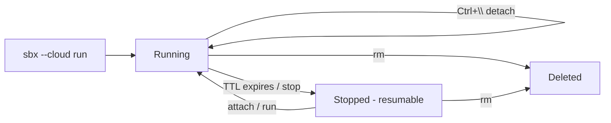

# Cloud Sandboxes - Overview

A local Docker Sandbox is bounded by one thing: your laptop. The microVM is only as fast as your CPU, it stops when you close the lid, and a long agent run - a migration, a full test suite, a large refactor - pins your machine for hours.

**Cloud Sandboxes** remove that ceiling. The agent runs on Docker-managed infrastructure instead of your host, driven by the *same* `sbx` CLI you already use locally. You add one global flag - `--cloud` - and the command is routed to the Cloud Sandboxes API instead of your local hypervisor.

> If you have not used local sandboxes yet, work through **Docker Sandboxes → Getting Started** first. Cloud sandboxes reuse the same mental model: a microVM, a credential proxy, and a network policy.

---

## Why run a sandbox in the cloud?

| Problem with local-only | What the cloud gives you |
|---|---|
| Long runs pin your laptop (fans, battery, lid open) | The job runs on remote hardware; close your laptop and reconnect later |
| Limited by your CPU/RAM | Pick a size up to 16 vCPU / 32 GB per sandbox |
| No nested virtualization on your host | Isolation runs on Docker's infrastructure regardless of your machine |
| One machine = a few parallel agents | Fan out many sandboxes at once via the API |

The mantra for this lab: **Develop locally. Scale in the cloud.**

---

## How cloud differs from local

Cloud and local sandboxes are the **same product with separate state**. A sandbox created locally does not appear in `sbx --cloud ls`, and vice-versa. The differences that matter:

- **No host workspace.** A cloud sandbox has its own filesystem. It *cannot* bind-mount a directory from your laptop. You copy your project in (`sbx --cloud cp`) or clone it inside the sandbox, then copy results back before deletion.
- **No host hardware.** USB, GPU passthrough from your machine, and host displays are local-only concepts.
- **Cloud-managed lifecycle.** Secrets, network policy, ports, and expiration (TTL) are managed on the server, not on your host.

Everything else - the agent (Claude Code, Codex, Gemini, …), the credential-proxy injection model, and the network policy layer - behaves exactly as it does locally.

---

## Lifecycle at a glance

A cloud sandbox **expires after one hour by default**. On expiration the service *stops* sandboxes that can be resumed and *deletes* the rest. You control this per-sandbox with `--ttl` and `--on-timeout` (covered in [Lifecycle & Expiration](lifecycle.md)).

---

## Cost model

Cloud sandboxes bill for compute while they run, by size. Pick the smallest size that fits the job and tear it down when you are done. Exact pricing and included credits are on Docker's [Signup and billing page](https://docs.docker.com/agentic-platform/signup/) - new Docker Agentic Platform accounts start with complimentary credits.

!!! tip "Stop paying the moment you're done"
    Billing is for running compute. `sbx --cloud stop <name>` halts a resumable sandbox; `sbx --cloud rm <name>` deletes it entirely. Make cleanup the last step of every exercise in this lab.

---

## What you'll build in this lab

| Module | You'll learn to |
|---|---|
| [Getting Started](getting-started.md) | Enable cloud access, store a credential, and run `sbx --cloud diagnose` |
| [Your First Cloud Sandbox](first-cloud-sandbox.md) | `run` an agent in the cloud, detach, and reconnect |
| [Lifecycle & Expiration](lifecycle.md) | Size, inspect, set TTL, stop/resume, and delete sandboxes |
| [Files, Ports & SSH](files-ports-ssh.md) | Copy files in/out, publish a port, and SSH into the VM |
| [Environment Files](environment-files.md) | Describe a reproducible cloud sandbox in `.sbxenv.yaml` |

---

## ✅ Checkpoint

You're ready to start when you understand:

- [ ] Cloud sandboxes use the **same `sbx` CLI** with a global `--cloud` flag
- [ ] Cloud and local sandboxes keep **separate state**
- [ ] A cloud sandbox **has no host workspace** - you copy data in and out
- [ ] Cloud sandboxes **expire after one hour by default** and bill for running compute

**Develop locally. Scale in the cloud.**

> **Source:** [Cloud sandboxes](https://docs.docker.com/ai/sandboxes/cloud/) on docs.docker.com.
