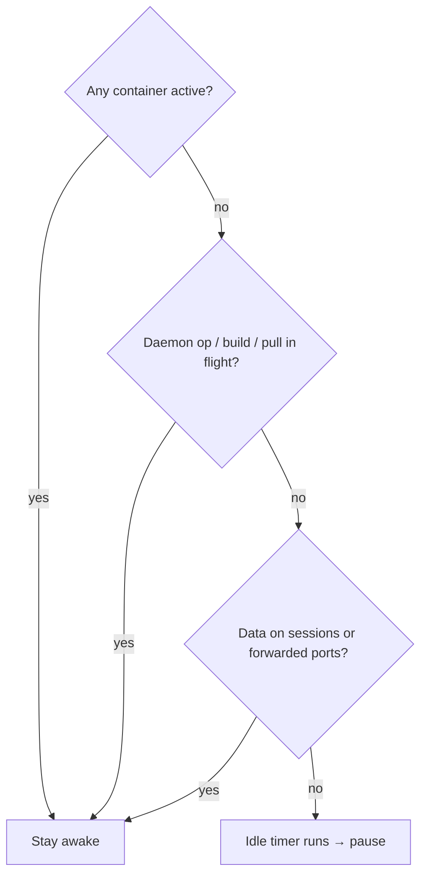

# Idle Timeout & Keep-Alive

Cloud compute costs money while it runs. The **idle timeout** is the mechanism that pauses a sandbox when a *connected* session goes quiet, so you stop paying automatically. This module is about tuning it so it never fires too early - or too late.

**Prerequisite:** [Creating & Sizing a Sandbox](create-and-size.md).

---

## The default: 5 minutes

Out of the box, a sandbox pauses after **5 minutes** of inactivity on a connected session. Configure it at (or after) creation:

```bash
docker offload create --idle-timeout 30m
```

Or disable idle pausing entirely:

```bash
docker offload create --keep-alive
```

### Rules

- **Minimum** timeout is **1 minute**; there is **no upper limit**.
- `--idle-timeout 0` behaves exactly like `--keep-alive`.
- You **cannot** combine `--keep-alive` and `--idle-timeout` in the same command.
- Changes apply **immediately** to a running sandbox - no recreate needed.
- The setting is **per-machine** and persists across sessions.
- A value in the config file **overrides** the CLI flag.

!!! tip "`--keep-alive` is a footgun for your wallet"
    `--keep-alive` disables the one safety net that stops billing when you walk away. Use it only for a known long-running task you're actively watching, and **always** pair it with a sensible [`--ttl`](ttl.md) so a disconnected laptop still gets you off the clock.

---

## What counts as "activity"?

The sandbox is considered **idle only when all** of these are true:

- No container is doing anything.
- No Docker daemon operations are in flight.
- No command, build, or image pull is in progress.
- No data is flowing through attached sessions or forwarded ports (evaluated after **1 minute** of port inactivity).

Conversely, a sandbox is **kept awake** when:

- A container is attached to the **host network**, or
- **Multiple containers** are running.



This is why a sandbox running your `docker compose up` stack won't pause mid-demo - the running containers keep it awake. It only starts the idle countdown once everything goes quiet.

---

## Choosing a value

| Scenario | Suggested setting |
|---|---|
| Interactive dev, frequent commands | default `5m` is usually fine |
| Long think-time between commands (reading logs, writing code) | `--idle-timeout 30m` |
| Unattended long build/test you're monitoring | `--keep-alive` **+** a bounded `--ttl` |
| Cost-sensitive / shared account | short timeout, e.g. `--idle-timeout 2m` |

---

## ✅ Checkpoint

- [ ] Set a custom `--idle-timeout` and confirmed it took effect immediately
- [ ] Understand `--idle-timeout 0` == `--keep-alive`, and that the two flags can't be combined
- [ ] Can list what keeps a sandbox awake vs. what lets it go idle
- [ ] Know that idle timeout only covers **connected** sessions - TTL covers the rest

Next: [Time to Live (TTL)](ttl.md).

> **Sources:** [Manage Docker Offload sandboxes](https://docs.docker.com/offload/usage/) and [Lifecycle, Idle Timeout & TTL](https://collabnix.com/docker-offload-cloud-sandboxes-lifecycle-idle-timeout-ttl/).
