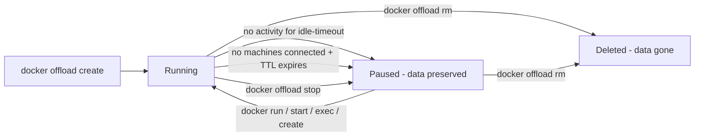

# Docker Offload Cloud Sandboxes - Overview

In the previous modules you enabled Docker Offload and ran builds and GPU workloads on cloud infrastructure. This workshop goes one level deeper into the piece that makes all of that possible: the **cloud sandbox** - the isolated cloud environment, with its own Docker daemon, where your offloaded containers actually run.

The whole value of Offload comes down to one thing: **the sandbox runs in the cloud, but it feels local.** Ports are forwarded back to your machine, bind-mounted files are synced, and you keep using the same `docker` CLI. The only real difference is where the work happens - and, crucially, **how long the environment stays alive and what it costs**.

That lifecycle - create, run, go idle, pause, resume, delete - is the focus of this workshop.

---

## The single-sandbox model

The most important mental model to internalize:

!!! info "One sandbox per account"
    You use **one Docker Offload cloud sandbox per account at a time.** It is a persistent environment, not a throwaway container. Stopping it **pauses** it (data preserved); it is not destroyed until you explicitly delete it. Multiple machines can connect to the *same* sandbox simultaneously.

This is different from local Docker, where every `docker run` is independent. With Offload:

- Your containers, images, and volumes live **inside the sandbox** and persist across pause/resume cycles.
- A second laptop that runs `docker offload create` connects to the **same** sandbox - it does not get a new one.
- Deleting the sandbox (`docker offload rm`) is **account-wide** and removes everything inside it.

---

## How this differs from Docker Sandboxes (`sbx`)

Both products run isolated environments in the cloud, but they solve different problems. Don't confuse them:

| | **Docker Offload ** | **Docker Sandboxes (`sbx` CLI)** |
|---|---|---|
| Purpose | Run your **normal Docker workflow** on cloud hardware | Isolate an **AI coding agent** (Claude Code, Codex, …) |
| CLI | `docker offload` / `docker --cloud …` | `sbx --cloud …` |
| Port forwarding | ✅ Ports forwarded to your machine | ❌ Not forwarded |
| File sync to host | ✅ Bind-mounted files synced back | ❌ Copy in/out explicitly |
| Model | One persistent sandbox per account | Many independent sandboxes |

!!! tip "Which one do I want?"
    Reach for **Offload** when you want regular `docker build` / `docker run` / `docker compose` on remote hardware with ports and files behaving as if local. Reach for **`sbx`** (covered in the *Docker Sandboxes* and *Cloud Sandboxes* labs) when you want to run an autonomous agent in a locked-down microVM.

---

## Lifecycle at a glance

Two independent timers govern when a **running** sandbox becomes **paused**:

- **Idle timeout** - fires when a *connected* session sits idle (default **5 minutes**).
- **TTL** - fires when *no machine is connected* at all (laptop asleep, network dropped). Max **24 hours**.

A **paused** sandbox costs nothing and keeps all its data. It resumes automatically the moment you issue an operational command.

---

## What you'll learn in this workshop

| Module | You'll learn to |
|---|---|
| [Prerequisites & Setup](getting-started.md) | Confirm you're on the sandbox-based Offload and reach a working `docker-cloud` context |
| [Creating & Sizing a Sandbox](create-and-size.md) | `create` with `--cpus` / `--memory`, inspect `status`, and resize with `--recreate` |
| [Idle Timeout & Keep-Alive](idle-timeout.md) | Tune `--idle-timeout`, use `--keep-alive`, and understand what counts as activity |
| [Time to Live (TTL)](ttl.md) | Protect disconnected sandboxes with `--ttl` and understand idle-vs-TTL |
| [Stop, Resume & Delete](stop-resume-delete.md) | Pause to stop billing, auto-resume, and tear down cleanly |
| [Multi-Machine & Hybrid Workflows](multi-machine.md) | Share one sandbox across machines and mix cloud + local contexts |
| [Troubleshooting & Cost Control](troubleshooting.md) | Diagnose the common gotchas and never leave compute running |

---

## ✅ Checkpoint

You're ready to start when you understand:

- [ ] Offload runs your **normal Docker workflow** on a persistent **cloud sandbox**
- [ ] There is **one sandbox per account**; `stop` pauses it, `rm` deletes it account-wide
- [ ] **Idle timeout** handles idle connected sessions; **TTL** handles disconnected machines
- [ ] A **paused** sandbox preserves data and costs nothing until resumed

> **Sources:** [Docker Offload](https://docs.docker.com/offload/) on docs.docker.com and [Docker Offload Cloud Sandboxes: Lifecycle, Idle Timeout & TTL](https://collabnix.com/docker-offload-cloud-sandboxes-lifecycle-idle-timeout-ttl/) on collabnix.com.
