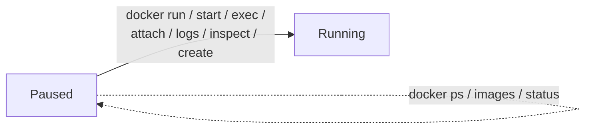

# Stop, Resume & Delete

You've seen the sandbox pause *automatically* via idle timeout and TTL. This module covers doing it *manually* - and the crucial difference between **pausing** (reversible, data kept) and **deleting** (gone for good).

**Prerequisite:** [Time to Live (TTL)](ttl.md).

---

## Stop = pause (data preserved)

```bash
docker offload stop
```

- Your active context switches back to **`desktop-linux`** immediately.
- The actual pause takes **a few minutes** to complete in the cloud - but **billing stops as soon as the pause begins**.
- `stop` is **account-wide**: it affects the sandbox for **all** connected machines.
- **All data persists** - containers, images, and volumes survive the pause.

!!! tip "Make `stop` the last step of every exercise"
    This is the single most effective cost control. The moment you're done with a sandbox, `docker offload stop` it. You keep all your state and pay nothing until you come back.

---

## Resume - there is no `resume` command

A paused sandbox **auto-resumes** the instant you run an **operational** command. Any of these wake it:

```text
docker run        docker start      docker exec
docker attach     docker logs       docker inspect
docker offload create
```

Query commands do **not** wake it: `docker ps`, `docker images`, and `docker offload status` all report the paused state without resuming.

!!! info "What's unavailable while paused"
    During a pause: `docker ps` / `docker images` return nothing, forwarded ports and file sync are unavailable, and any attached or `exec` sessions are terminated. A fully-paused sandbox resumes within about a minute once you issue an operational command.



---

## Delete = destroy (data gone)

```bash
docker offload rm            # prompts for confirmation
docker offload rm --force    # skips the prompt
```

- Removes the sandbox and **all its contents**, whether it's running or paused.
- Like `stop`, this is **account-wide**.
- The next `docker offload create` provisions a **brand-new** sandbox with the default **5-minute** idle timeout.

!!! danger "`rm` is irreversible and account-wide"
    `docker offload rm` deletes containers, images, and volumes for **everyone on the account**. Push anything you want to keep to a registry first. Use `stop` when you just want to pause.

---

## Stop vs. Delete - decision table

| You want to… | Command | Data | Billing |
|---|---|---|---|
| Take a break, come back later | `docker offload stop` | **Kept** | Stops |
| Free the account entirely | `docker offload rm` | **Destroyed** | Stops |
| Change CPU/memory | `docker offload create --recreate` | **Destroyed** | Resets |

---

## ✅ Checkpoint

- [ ] Paused the sandbox with `docker offload stop` and saw the context revert to `desktop-linux`
- [ ] Resumed it with an operational command (e.g. `docker run`) - and confirmed `status` alone does **not** resume
- [ ] Understand `rm` destroys data account-wide and `--force` skips the prompt
- [ ] Can articulate when to `stop` vs. `rm`

Next: [Multi-Machine & Hybrid Workflows](multi-machine.md).

> **Sources:** [Manage Docker Offload sandboxes](https://docs.docker.com/offload/usage/) and [Lifecycle, Idle Timeout & TTL](https://collabnix.com/docker-offload-cloud-sandboxes-lifecycle-idle-timeout-ttl/).
