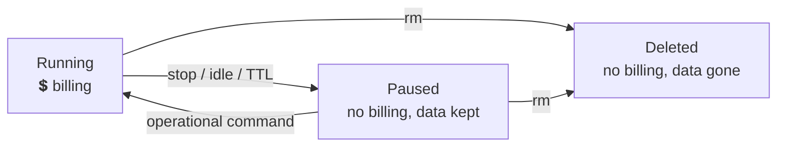

# Troubleshooting & Cost Control

The gotchas with Offload cloud sandboxes are almost always about **which context you're in** and **which timer is (or isn't) running**. This closing module collects the fixes and distills the habits that keep your bill small.

**Prerequisite:** [Multi-Machine & Hybrid Workflows](multi-machine.md).

---

## Troubleshooting checklist

| Symptom | Likely cause | Fix |
|---|---|---|
| Builds run locally, not in the cloud | Wrong context | `docker context ls`; select `docker-cloud` or prefix with `docker --cloud …` |
| `unknown flag: --cloud` | Flag placed after the subcommand | Move it **before**: `docker --cloud build .` |
| My containers are "missing" | You're in the other context | Use `--context desktop-linux` for local; `docker-cloud` for cloud |
| Containers suddenly vanished | Sandbox got paused | Run an operational command (`docker start`, `docker logs`) to resume |
| Sandbox pauses too soon | Idle timeout too short | Raise `--idle-timeout`, or use `--keep-alive` (+ a `--ttl`) |
| Paused while I was disconnected | No / short TTL | Set a longer `--ttl` (max 24h) |
| Resume feels slow | A pause was still completing | Let the in-progress pause finish; a fully-paused sandbox resumes in ~1 min |
| `docker offload status` shows paused but won't wake | Expected - `status` is a query | Issue an operational command to resume |

---

## Cost-control habits

!!! tip "Five rules that keep the bill small"
    1. **Right-size at creation.** Start small (`--cpus 2`); only `--recreate` larger when you've proven you need it.
    2. **Keep a sane idle timeout.** The 5-minute default is a feature, not a nuisance. Shorten it on shared accounts.
    3. **Always set a TTL** on anything unattended - it's your backstop for sleeping laptops and dropped networks.
    4. **Never leave `--keep-alive` unbounded.** Pair it with `--ttl` every time.
    5. **`docker offload stop` the moment you're done.** Billing stops immediately; data is preserved.

Remember the three money-relevant states:



---

## Quick reference

```bash
# Create / connect, sized, with both timers bounded
docker offload create --cpus 8 --memory 16g --idle-timeout 30m --ttl 6h

# Inspect (never wakes a paused sandbox)
docker offload status

# Resize (DESTROYS data — push images first)
docker offload create --cpus 16 --memory 32g --recreate

# Pause to stop billing (data preserved, account-wide)
docker offload stop

# Resume: just run any operational command
docker run hello-world

# Delete everything (account-wide, irreversible)
docker offload rm --force

# Offload a single command without switching context
docker --cloud build .
```

---

## ✅ Workshop complete

You can now:

- [ ] Diagnose context and pause-state issues from the symptom table
- [ ] Size a sandbox and resize safely with `--recreate`
- [ ] Bound cost with `--idle-timeout`, `--keep-alive`, and `--ttl`
- [ ] Pause, resume, and delete deliberately
- [ ] Share one sandbox across machines and mix cloud + local work

**Create small. Bound both timers. Stop when you're done.**

> **Sources:** [Docker Offload troubleshooting](https://docs.docker.com/offload/troubleshooting/) and [Docker Offload Cloud Sandboxes: Lifecycle, Idle Timeout & TTL](https://collabnix.com/docker-offload-cloud-sandboxes-lifecycle-idle-timeout-ttl/).
