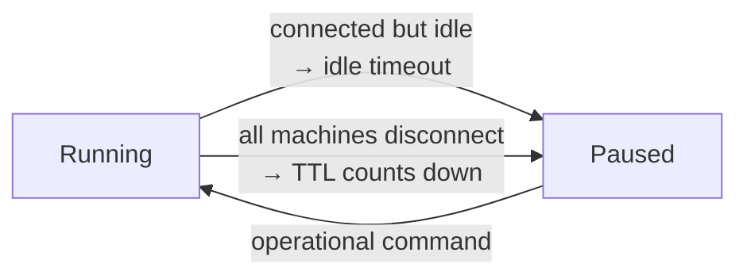

# Time to Live (TTL)

Idle timeout protects you while you're **connected but quiet**. But what happens when your laptop sleeps, you close the lid, or the network drops? The connected session ends - and idle detection can no longer see your sandbox. **TTL** is the backstop for exactly that case.

**Prerequisite:** [Idle Timeout & Keep-Alive](idle-timeout.md).

---

## Set a TTL

```bash
docker offload create --ttl 8h
```

- TTL is the sandbox's lifetime **while no machine is connected**.
- Maximum is **24 hours**.

### How the countdown behaves

!!! info "TTL only counts down when nobody is connected"
    While **at least one machine is connected**, Docker Offload **continuously renews** the TTL - it never expires out from under an active user. The countdown starts **only when all machines disconnect**. When it reaches zero, the sandbox is **paused** (data preserved), not deleted.

This is what covers the "I closed my laptop and went to lunch" scenario: idle detection can't act because there's no live session, so TTL takes over and pauses the sandbox so you stop paying.

---

## Idle timeout vs. TTL

The two timers are complementary - they cover different failure modes. You generally want **both** set.

| | **Idle timeout** | **TTL** |
|---|---|---|
| Covers | Inactive but **connected** session | **Disconnected** / sleeping machine |
| Trigger | No activity for the timeout window | No machine connected for the TTL window |
| Default | 5 minutes | set per-sandbox; max 24h |
| Result | Pause | Pause |
| Renews while connected? | n/a (watches activity) | **Yes** - resets continuously |



---

## A belt-and-suspenders setup

For an unattended long job you're only loosely watching:

```bash
docker offload create --cpus 8 --memory 16g --keep-alive --ttl 6h
```

- `--keep-alive` stops idle timeout from pausing the job while you're away from the keyboard but still connected.
- `--ttl 6h` guarantees that if your machine disconnects (sleep, VPN drop), the sandbox pauses within 6 hours instead of billing indefinitely.

!!! warning "`--keep-alive` without a TTL can bill forever"
    If you disable idle pausing **and** don't set a TTL, a disconnected sandbox has nothing to pause it. Always bound a kept-alive sandbox with `--ttl`.

---

## ✅ Checkpoint

- [ ] Created a sandbox with an explicit `--ttl`
- [ ] Understand TTL **renews while connected** and only counts down once disconnected
- [ ] Can explain why you'd set **both** an idle timeout and a TTL
- [ ] Always pair `--keep-alive` with a bounded `--ttl`

Next: [Stop, Resume & Delete](stop-resume-delete.md).

> **Sources:** [Manage Docker Offload sandboxes](https://docs.docker.com/offload/usage/) and [Lifecycle, Idle Timeout & TTL](https://collabnix.com/docker-offload-cloud-sandboxes-lifecycle-idle-timeout-ttl/).
